<a id="readme-top"></a>

<!-- SHIELDS -->
<div align="center">

[![CI][ci-shield]][ci-url]
[![Latest release][release-shield]][release-url]
[![License][license-shield]][license-url]

![Platform][platform-shield]
![Min SDK][minsdk-shield]
![Runtime dependencies][deps-shield]

<br />


</div>

# Thor Back Button Hero

> [!NOTE]
> **Get more out of the Back button on your [AYN Thor](https://www.ayntec.com/products/ayn-thor).**
> Double-tap for an app switcher on the bottom screen, hold to swap both screens, and put your favorite
> actions on L1, L2, R1, R2 and the D-pad: screenshots, volume, brightness, controller focus and more.
> <ins>No root required. Free and open source.</ins>
>
> Every setting is optional. The app is lean by design, and none of the gestures or hotkeys has to be used.
>
> I don't earn anything from this app and don't even know how many people use it. If it helps you, a [star on GitHub](https://github.com/denissteinhorst/thor-back-button-hero) would mean a lot.
>
> [Download the latest release][release-url] · [Try the interactive explainer][explainer-url]

## One button, many possibilities

<div align="center">

<video src="https://github.com/user-attachments/assets/fe2d9c3a-b73b-416f-9198-39178ad2ff0e" width="640" controls muted></video>
<br>
<sub><a href="https://github.com/user-attachments/assets/fe2d9c3a-b73b-416f-9198-39178ad2ff0e">Open the Back Button Hero 1.3.0 gesture preview as a video</a></sub>

</div>

**Single tap:** Sends a regular Back or opens the launcher on the bottom screen.

**Double tap:** Opens an app switcher on the bottom screen, which the Thor does not have on its own. It shows a card for every app opened there. Tap a card to open the app, swipe it up to close it, or use "Close all". *(Timing adjustable.)*

**Tap, then hold:** Opens the system's Recents on the top screen. *(Timing adjustable.)*

**Hold:** Swaps the apps on the top and bottom screens. *(Timing adjustable.)*

Each gesture can be switched off in the app's settings.

## Shoulder buttons and D-pad

Hold Back and press another button to run a shortcut. The shoulder buttons **L1, L2, R1, R2** and the four D-pad directions **D-pad left, D-pad up, D-pad right, D-pad down** can each be assigned any action from the list below. A button without an assignment is left alone, so games and apps still receive its normal input.

**Available actions:**

- **Launch an app** on the top or bottom screen
- **Navigation flick** to the previous or next app.
- **Home**
- **Recents**
- **Screenshot** of the top screen, the bottom screen, or both. The bottom screen is saved to `Pictures/Screenshots`.
- **Volume up / down** on both screens, only the top, or only the bottom.
- **Brightness up / down** on both screens, only the top, or only the bottom.
- **Set controller focus** to the top or bottom screen, either as a toggle or fixed to one screen. A short pictogram confirms the active screen. Its position (a 3 × 3 grid), display time, and visibility can be set; tapping the pictogram opens these settings.
- **Quick Settings** and **notifications**
- **System settings pages:** Wi-Fi and internet, Bluetooth, Night Light, Extra Dim, Display, Sound, Location, Cast, Do Not Disturb, Battery Saver
- **Not set**

## Your default Settings and Binds

On a fresh install, or after **Reset settings**, a single tap opens the launcher on the bottom screen, a double tap opens the app switcher (300 ms window), tap then hold opens Recents on the top screen (1000 ms), and hold swaps both screens (1000 ms).

The optional hotkeys start out like this. You can change or remove any of them, and **Unbind optionals** clears all of them at once.

| Button | Default action |
|---|---|
| **L1** | Navigation flick left |
| **R1** | Navigation flick right |
| **L2** | Screenshot, top screen only |
| **R2** | Set controller focus: toggle between the screens |
| **D-pad up** | Brightness up, both screens |
| **D-pad down** | Brightness down, both screens |
| **D-pad left** | Volume down, both screens |
| **D-pad right** | Volume up, both screens |

The controller-focus pictogram appears at the center right of the top screen for 500 ms, unless you change this for a button.

## How the D-pad shortcuts work

The game keeps running and never sees a D-pad shortcut. Normal apps cannot read the Thor's D-pad without taking focus away from the game, so the app uses a root service that AYN's firmware already provides. Back Button Hero uses it for exactly one thing: starting a tiny helper program that sits between the controller and Android and holds back D-pad presses made while Back is held. Your device is not rooted.

| | |
|---|---|
| **What the helper can do** | Pass the controller's input on unchanged, except D-pad presses made while Back is held. |
| **What it cannot do** | By design it has no network access, reads no files and cannot see the screen. It only opens the controller, a virtual controller, and a private connection to the app. |
| **Where it runs** | As a small separate program (about 300 lines, in this repository), started through AYN's root service. Only the app can talk to it. |
| **If it's unavailable** | Shortcuts still work, but games may pause while Back is held. The settings screen shows a warning. |

Full explanation: [`docs/HELPER.md`](docs/HELPER.md)

## Is it safe?

Back Button Hero uses Android's Accessibility Service, which is a powerful permission.
Here is what that means in practice:

- **Open source.** Every line is in this repository, and releases are built by GitHub Actions from this code.
- **No tracking.** No analytics, no telemetry, no accounts.
- **One network request.** An HTTPS call to GitHub to check for updates. It sends no settings, app list or screenshots.
- **Only your hardware buttons.** It acts on Back, L1, L2, R1, R2 and the D-pad. All other keys, including typing on a keyboard, are passed on untouched and are never stored or logged ([`onKeyEvent`](app/src/main/java/dev/steinhorst/backbuttonhero/SwitcherService.kt)).
- **No reading of app content.** The service sees which apps are open, not the text inside them.
- **Nothing leaves your device.** Switcher previews live in memory only and are discarded when the service stops.
- **Easy to undo.** Switch the service off or uninstall the app, and everything is gone.

Details: [Accessibility, permissions & privacy](#accessibility-permissions--privacy) ·
[D-pad helper](#how-the-d-pad-shortcuts-work) ·
[Verify your download](#verify-your-download) ·
[FAQ](docs/FAQ.md)

## Compatibility

Tested on an **AYN Thor Max 16GB/1TB (Rainbow), 1st Batch**: Android 13,
firmware `Thor_V1.0.0.377_20260206_165408_user`. The app uses no model-specific
features, so other Thor variants (Base, Pro, Max512) should work too. If yours
doesn't, please [open an issue](https://github.com/denissteinhorst/thor-back-button-hero/issues)
with your model and firmware version.

Other devices, Android versions, and what the app needs from the hardware:
see the [FAQ](docs/FAQ.md#compatibility).

## Screenshots of the app's settings

These are the app's own settings screens. Everything shown can be changed,
and the defaults work out of the box.

<table>
<tr><td width="50%" align="center">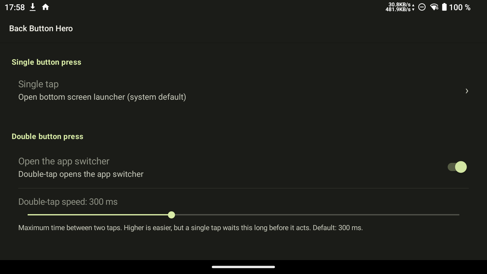<br><sub><b>Single &amp; double press</b> — tap action and double-tap speed</sub></td><td width="50%" align="center">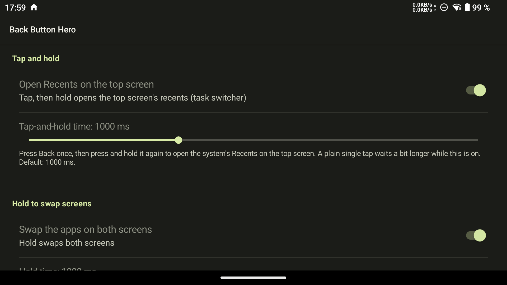<br><sub><b>Tap and hold</b> — Recents on the top screen</sub></td></tr>
<tr><td width="50%" align="center">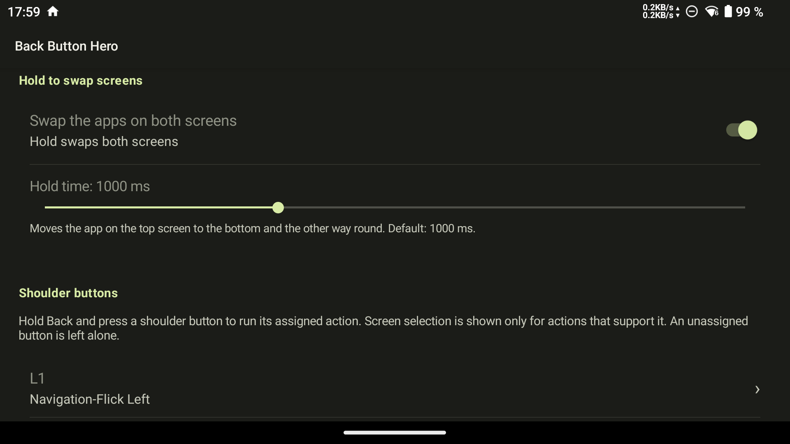<br><sub><b>Hold to swap screens</b> — and its hold time</sub></td><td width="50%" align="center">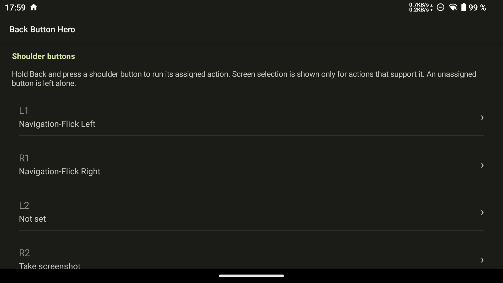<br><sub><b>Shoulder buttons</b> — L1, L2, R1, R2</sub></td></tr>
<tr><td width="50%" align="center">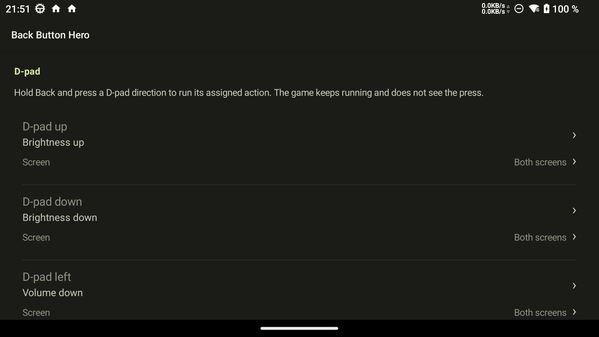<br><sub><b>D-pad shortcuts</b> — per-direction actions and screen targets</sub></td><td width="50%" align="center">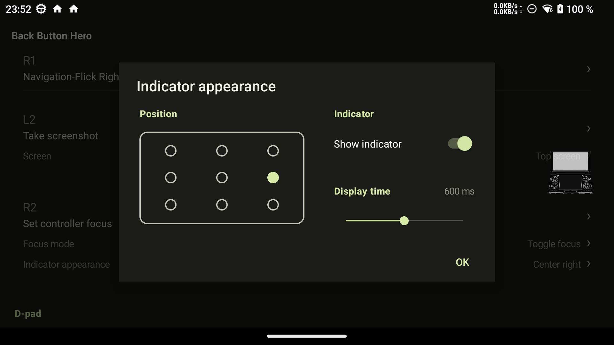<br><sub><b>Indicator appearance</b> — position, visibility and display time of the focus pictogram</sub></td></tr>
</table>

<details>
<summary><b>More screenshots</b> (5)</summary>
<br>

<table>
<tr><td width="50%" align="center">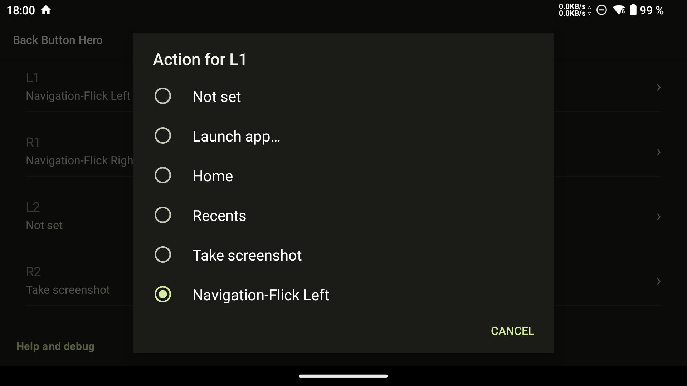<br><sub><b>Pick an action</b> — Home, Recents, screenshot, flicks</sub></td><td width="50%" align="center">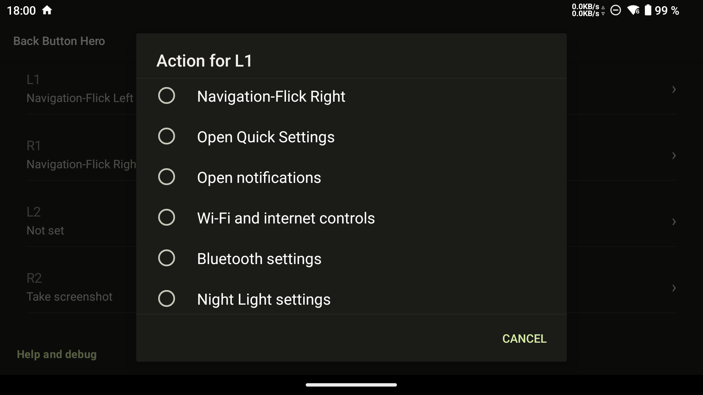<br><sub><b>System shortcuts</b> — Quick Settings, notifications, Wi-Fi</sub></td></tr>
<tr><td width="50%" align="center">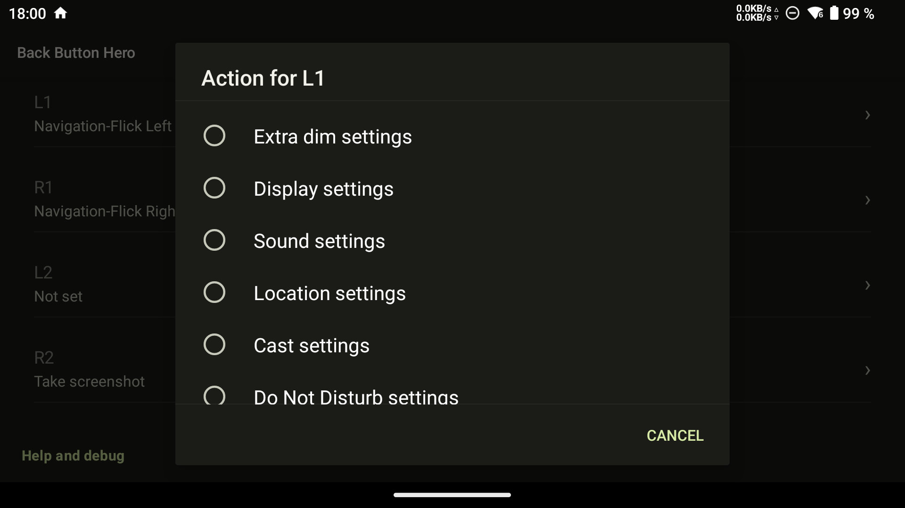<br><sub><b>Settings pages</b> — display, sound, location and more</sub></td><td width="50%" align="center">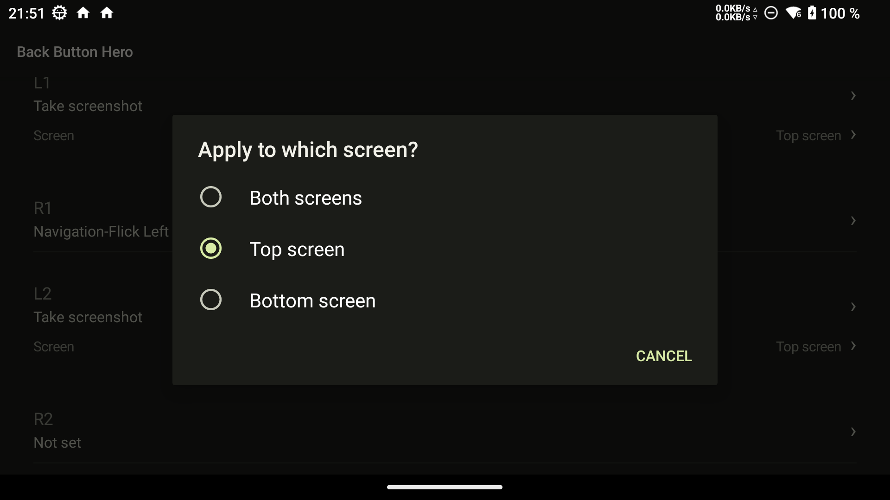<br><sub><b>Screenshot target</b> — both screens, top, or bottom</sub></td></tr>
<tr><td width="50%" align="center" colspan="2">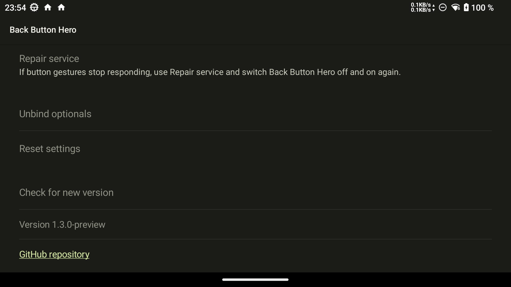<br><sub><b>Help and maintenance</b> — repair service, unbind optionals, reset, update check</sub></td></tr>
</table>

</details>

## Settings and service health

The settings screen shows whether the accessibility service is running. If
gestures stop responding, **Repair service** takes you straight to the right
toggle in Android's settings, because Android does not let an app re-enable its
own accessibility service.

- **Unbind optionals** removes the assignments of all four shoulder buttons and
  all four D-pad directions in one step. Gesture timings and other settings
  stay as they are.
- **Reset settings** restores every gesture timing, switch, button assignment,
  and screen target to its default. Android permissions and the state of the
  accessibility service are not changed.
- **Check for updates** asks GitHub Releases for a newer version, in addition to
  the automatic background check. This is useful right after installing.

Settings are kept when you update the app. A new version only applies its
defaults to settings you have never changed, and it does not overwrite buttons
you have assigned or deliberately left empty.

## Small footprint

With the accessibility service enabled and idle in the background, Back
Button Hero used **7.8 MiB PSS** and `top` rounded its CPU use to **0.0%** in
five consecutive one-second samples. This is a small footprint for a service
that stays ready to handle button input.

<details>
<summary>How this was measured</summary>

Measured live over ADB on 25 October 2026 on an AYN Thor Max 16GB/1TB
(Rainbow), 1st Batch, Android 13, firmware
`Thor_V1.0.0.377_20260206_165408_user`. At the time of measurement, the app
had no open activities. `dumpsys meminfo` reported
7,998 KiB PSS and 96,204 KiB RSS; RSS includes shared resident pages, while
PSS apportions shared pages and is the more useful estimate of memory
attributable to this process. CPU was sampled with `top -b -d 1 -n 5 -p <pid>`.
These are idle-state readings, not a peak-use benchmark; actual usage varies
with device state and activity, and opening the switcher briefly captures a
screen preview.

</details>

## Installing

This isn't on the Play Store. Grab the latest APK from
[Releases](../../releases), [verify it](#verify-your-download), install it, then:

1. Open Back Button Hero once and tap **Turn on accessibility service**.
2. In Android's Accessibility settings, select Back Button Hero and switch on
   its service. **Android will show a standard warning** that the service can
   observe your actions and see what is on the screen. Android shows this for
   *every* accessibility app; it is generic, not specific to this one. What Back
   Button Hero actually does with the permission is listed under
   [Accessibility, permissions & privacy](#accessibility-permissions--privacy).
   Android requires you to enable this yourself; the app cannot do it for you.
3. Return to Back Button Hero and check that the service status shows as on.
4. On Android 13 and later, allow notifications if you want update alerts.

The app checks GitHub Releases for updates and notifies you when a newer one
is available — no auto-install, it just links to the release page.

### Verify your download

Every release is signed with the same key, and GitHub shows a SHA-256 checksum next to each file.

| | |
|---|---|
| **Signing certificate SHA-256** | `7f8ab05139a406a3d50ba6267c60228b90935f4c02f854c26d69cf1b275df3ee` |
| **APK checksum** | shown next to the file in each [release](../../releases) |

Check the file before installing:

```sh
shasum -a 256 thor-back-button-hero-v<version>.apk
```

To check the signing key (`apksigner` is part of the Android SDK build tools):

```sh
apksigner verify --print-certs thor-back-button-hero-v<version>.apk
```

The certificate digest it prints must match the one above. An update signed with
a different key will not install over the existing app. If Android refuses an
update, don't force it. Open an issue instead.

## Accessibility, permissions & privacy

The accessibility service is what lets Back Button Hero recognize Back,
shoulder-button and D-pad input, find which apps are open on each screen, and
show the app switcher. Because Android grants it broad capabilities, here is
exactly what the app uses them for:

<details>
<summary>What does the Accessibility Service access?</summary>

It receives Back, shoulder-button and D-pad events, plus window-change events.
It uses app window/package information to build the recent-app list for each
screen, and takes a screenshot of the bottom screen to make the switcher's
preview cards. Screenshots and the recent-app history are kept in memory for
the switcher; they are not saved as files. The service also uses Android
accessibility actions to perform configured gestures and shortcuts.

**Which keys does it see?** Android delivers key presses to accessibility
services that ask for them, so the service technically receives every key press.
Back Button Hero acts only on Back, L1, L2, R1, R2 and, through the helper, the
D-pad. Everything else is passed on untouched, and key presses are never stored
or logged. The code is `onKeyEvent` in
[`SwitcherService.kt`](app/src/main/java/dev/steinhorst/backbuttonhero/SwitcherService.kt).

**Does it read window contents?** No. Android requires the "retrieve window
content" capability for an app to learn which app is open in each window, so it
is switched on in the
[service configuration](app/src/main/res/xml/accessibility_config.xml). The app
uses it for one thing: the package name of each window. It never reads text,
input fields or other content.

</details>

<details>
<summary>What is stored on the device?</summary>

Gesture timings, enabled actions, shoulder-button and D-pad assignments, screen
targets, and related settings are stored in the app's private preferences.
Recent-app history and preview images are held in memory while the service is
running. The app does not send this information to its developer.

</details>

<details>
<summary>What network connections does the app make?</summary>

The app makes an HTTPS request to the GitHub Releases API to check for the
latest version. It retrieves the release version and link, then opens the
release page if you choose to update. The request does not include your app
settings, app list, or screenshots. GitHub receives the usual connection
metadata for an HTTPS request, such as your IP address. Back Button Hero has
no analytics or telemetry.

</details>

<details>
<summary>Why does it need the other Android permissions?</summary>

- **Package visibility:** lets the app find installed apps so it can list and
  launch them in the switcher and shortcut settings.
- **Background process management:** lets the switcher's close actions ask
  Android to stop an app's background process. Android controls what can
  actually be stopped.
- **Internet:** used for the GitHub update check described above.
- **Notifications:** used to alert you when an update is available. On Android
  13 and later, notification permission can be declined; update checks remain
  available from the settings screen.

</details>

**Removing it completely:** turn the service off in Android's Accessibility
settings, then uninstall the app. Settings live only in the app's private
storage and go with it. The app's **Reset settings** action clears its saved
gesture and button preferences, but does not change Android permissions or the
service state.

## Troubleshooting & support

- **Gestures stop responding:** open Back Button Hero and check the service
  status. Use **Repair service** to jump to Android's Accessibility settings,
  switch the service off, then on again.
- **Update notifications do not appear:** check Android's notification
  permission for Back Button Hero. You can always check manually from the app's
  settings.
- **An app is missing from the switcher:** the list is built from apps seen
  since the accessibility service started; reopen the app on that screen and
  open the switcher again.

For bugs or feature requests, open a
[GitHub Issue](https://github.com/denissteinhorst/thor-back-button-hero/issues).
Include your Thor model, Android/firmware version, app version, and steps to
reproduce the problem. Back Button Hero is a hobby project maintained as time
allows; there is no guaranteed response time or commitment to implement every
request.

## Building from source

```sh
./gradlew assembleDebug
```

Requires JDK 17. `minSdk` is 30 (Android 11).

## Project documentation

The app can be used without reading these, but the repository includes more
detail for people who want to understand or work on it:

- [FAQ](docs/FAQ.md) — device compatibility, how updating works, and the
  privacy and trust questions an accessibility service ought to answer.
- [Helper service](docs/HELPER.md) — what the AYN firmware helper does and why
  the D-pad shortcuts need it.
- [Interactive gesture explainer][explainer-url] — a clickable device diagram
  showing what each Back-button gesture does. Self-contained; open the
  downloaded file in any browser.
- [Architecture](docs/ARCHITECTURE.md) — the main components, how a gesture
  flows through the app, and how it targets the two displays.
- [Testing and quality gates](docs/TESTING.md) — the automated verification
  command, CI checks, coverage boundaries, and what the tests are intended to
  protect.
- [Manual testing procedures](docs/MANUAL-TESTING.md) — when a real Thor test
  is needed and the repeatable steps for checking settings, gestures, the
  switcher, shoulder buttons, D-pad shortcuts, and releases.
- [Project structure](docs/PROJECT-STRUCTURE.md) — a file-by-file guide to
  the source tree, resources, tests, and automation.
- [Build and maintenance guide](docs/MAINTENANCE.md) — developer setup,
  everyday commands, safe change recipes, dependency updates, and release
  procedures.

## About this project

This app was built with AI assistance: I directed, reviewed, and tested
every part of it myself, using OpenAI's Codex (GPT-5.6 Sol and GPT-5.6 Luna)
and Anthropic's Claude Code (Sonnet 5.5 and Opus 5.5) as the coding tools. The visual assets — the app
icon and the illustrations and animation in this README — were likewise
created with AI assistance, using OpenAI's ChatGPT. As a full-stack software
engineer with several years of professional experience, I built it to the best of
my knowledge and have used it extensively on my own AYN Thor. It is a
hobby project and may contain bugs; see [Troubleshooting & support](#troubleshooting--support)
for how to report one and what support to expect.

## Third-party licenses

The app itself ships with zero runtime dependencies beyond the Kotlin standard library
(Apache-2.0), which the Kotlin Gradle plugin adds automatically. The test suite under
`app/src/test` and `app/src/androidTest` depends on JUnit (EPL-1.0), Robolectric (MIT),
AndroidX Test / Espresso / UiAutomator (Apache-2.0), and JaCoCo (EPL-2.0) — none of these
are included in the release APK. You can verify that mechanically — the release runtime
classpath resolves to nothing but the Kotlin standard library:

```sh
./gradlew :app:dependencies --configuration releaseRuntimeClasspath
```

LeakCanary (Apache-2.0) is `debugImplementation`-only and ships in debug builds alone,
never in release.

## License

0BSD — see [LICENSE](LICENSE).

<!-- SHIELD DEFINITIONS -->
[ci-shield]: https://img.shields.io/github/actions/workflow/status/denissteinhorst/thor-back-button-hero/ci.yml?branch=main&style=for-the-badge&label=CI
[ci-url]: https://github.com/denissteinhorst/thor-back-button-hero/actions/workflows/ci.yml
[release-shield]: https://img.shields.io/github/v/release/denissteinhorst/thor-back-button-hero?style=for-the-badge
[release-url]: https://github.com/denissteinhorst/thor-back-button-hero/releases/latest
[explainer-url]: https://github.com/denissteinhorst/thor-back-button-hero/releases/latest/download/gesture-explainer.html
[license-shield]: https://img.shields.io/github/license/denissteinhorst/thor-back-button-hero?style=for-the-badge
[license-url]: https://github.com/denissteinhorst/thor-back-button-hero/blob/main/LICENSE
[platform-shield]: https://img.shields.io/badge/platform-Android-3DDC84?style=for-the-badge&logo=android&logoColor=white
[minsdk-shield]: https://img.shields.io/badge/min%20SDK-30%20(Android%2011)-3DDC84?style=for-the-badge
[deps-shield]: https://img.shields.io/badge/runtime%20dependencies-none-success?style=for-the-badge
