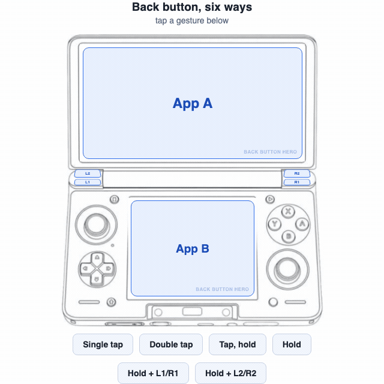

<a id="readme-top"></a>

<!-- SHIELDS -->
<div align="center">

[![CI][ci-shield]][ci-url]
[![Latest release][release-shield]][release-url]
[![License][license-shield]][license-url]

![Platform][platform-shield]
![Min SDK][minsdk-shield]
![Runtime dependencies][deps-shield]

<br />


</div>

# Thor Back Button Hero

> [!NOTE]
> A tiny Android accessibility service that gives the **Back button** on
> dual-screen handhelds (built for the [AYN Thor](https://www.ayntec.com/products/ayn-thor)) a lot
> more jobs: app switching, screen swapping, task switching, and up to four
> fully customizable shoulder-button shortcuts — on top of what Back already
> does.
>
> No root or companion app required.
>
> **Install:** grab the APK from [Releases][release-url], install it, then switch
> on its accessibility service when the app asks.

## Compatibility

Tested on an **AYN Thor Max 16GB/1TB (Rainbow), 1st Batch** — Android 13,
firmware `Thor_V1.0.0.377_20260206_165408_user`. Nothing in the app depends on
that configuration, so it should run on any Thor, Base and Pro and Max512
alike.

Other devices, Android versions, and what the app needs from the hardware:
see the [FAQ](docs/FAQ.md#compatibility).

## What one Back button can do for you

<div align="center">



**Want to try the gestures before installing anything?**
[Download the interactive explainer](docs/gesture-explainer.html) — a clickable
device diagram, no APK and no permissions involved.

</div>

Open that page on GitHub and use its **Download raw file** button, then
double-click the downloaded file to open it in your browser. It is a single
self-contained file and works offline. (GitHub never renders repository HTML
directly, so a link straight to the file would only show you its source.)

| Gesture | Action |
|---|---|
| **Single tap** | Normal Back, or opens the bottom screen's launcher — your choice |
| **Double tap** | Opens an app-switcher overlay on the bottom screen — something the Thor doesn't have on its own — with cards for every app that's been opened there |
| **Hold** | Swaps the apps on the top and bottom screens |
| **Tap, then hold** | Opens the system's Recents (task switcher) on the top screen instead of swapping |
| **Hold + L1 / L2 / R1 / R2** | Runs whatever action is assigned to that shoulder button — see below |

In the switcher overlay: tap a card to open it, swipe a card up to close it,
or use "Close all" (optionally across both screens at once).

All timings (double-tap window, hold duration), the single-tap behavior, and
whether double-tap/hold/tap-hold are enabled at all are configurable from
the app's settings screen.

## Shoulder-button shortcuts

Hold Back and press L1, L2, R1, or R2 to run a per-button action, independent
of what Back alone does. L1 and R1 default to a navigation flick (quick
previous/next-app swipe), but every button — including L1/R1 — can be
freely reassigned to whatever action you want from the list below:

- Launch a chosen app, on the top or bottom screen
- A navigation flick (quick previous/next-app swipe)
- Home, Recents, or a screenshot
- Open Quick Settings or the notification shade
- Jump straight to a system settings panel: Wi-Fi & internet, Bluetooth,
  Night Light, Extra Dim, Display, Sound, Location, Cast, Do Not Disturb, or
  Battery Saver

An unassigned button is left alone, so games and apps still see its normal
input.

## Settings & service health

The settings screen shows whether the accessibility service is on, and has
a "Repair service" shortcut for the rare case where gestures stop
responding — Android won't let an app re-enable its own accessibility
service, so this walks you straight to the right toggle instead.

- **Reset settings** restores every gesture timing, switch, and
  shoulder-button assignment to its default. It doesn't touch Android
  permissions or the accessibility-service state.
- **Check for new version** manually asks GitHub Releases for a newer
  build, on top of the automatic background check — useful right after
  install, when there's nothing to compare against yet.

## Small footprint

With the accessibility service enabled and idle in the background, Back
Button Hero used **7.8 MiB PSS** and `top` rounded its CPU use to **0.0%** in
five consecutive one-second samples. This is a small footprint for a service
that stays ready to handle button input.

Measured live over ADB on 25 October 2026 on an AYN Thor Max 16GB/1TB
(Rainbow), 1st Batch, Android 13, firmware
`Thor_V1.0.0.377_20260206_165408_user`. At the time of measurement, the app
had no open activities. `dumpsys meminfo` reported
7,998 KiB PSS and 96,204 KiB RSS; RSS includes shared resident pages, while
PSS apportions shared pages and is the more useful estimate of memory
attributable to this process. CPU was sampled with `top -b -d 1 -n 5 -p <pid>`.
These are idle-state readings, not a peak-use benchmark; actual usage varies
with device state and activity, and opening the switcher briefly captures a
screen preview.

## Installing

This isn't on the Play Store. Grab the latest APK from
[Releases](../../releases), install it, then:

1. Open Back Button Hero once and tap **Turn on accessibility service**.
2. In Android's Accessibility settings, select Back Button Hero and switch on
   its service. Android requires you to enable this yourself; the app cannot
   turn it on for you.
3. Return to Back Button Hero and check that the service status shows as on.
4. On Android 13 and later, allow notifications if you want update alerts.

The app checks GitHub Releases for updates and notifies you when a newer one
is available — no auto-install, it just links to the release page.

## Accessibility, permissions & privacy

The accessibility service is what lets Back Button Hero recognize Back and
shoulder-button input, find which apps are open on each screen, and show the
app switcher. Because Android grants it broad capabilities, here is exactly
what the app uses them for:

<details>
<summary>What does the Accessibility Service access?</summary>

It receives Back and shoulder-button events and window-change events. It uses
app window/package information to build the recent-app list for each screen,
and takes a screenshot of the bottom screen to make the switcher's preview
cards. Screenshots and the recent-app history are kept in memory for the
switcher; they are not saved as files. The service also uses Android
accessibility actions to perform configured gestures and shortcuts.

</details>

<details>
<summary>What is stored on the device?</summary>

Gesture timings, enabled actions, shoulder-button assignments, and related
settings are stored in the app's private preferences. Recent-app history and
preview images are held in memory while the service is running. The app does
not send this information to its developer.

</details>

<details>
<summary>What network connections does the app make?</summary>

The app makes an HTTPS request to the GitHub Releases API to check for the
latest version. It retrieves the release version and link, then opens the
release page if you choose to update. The request does not include your app
settings, app list, or screenshots. GitHub receives the usual connection
metadata for an HTTPS request, such as your IP address. Back Button Hero has
no analytics or telemetry.

</details>

<details>
<summary>Why does it need the other Android permissions?</summary>

- **Package visibility:** lets the app find installed apps so it can list and
  launch them in the switcher and shortcut settings.
- **Background process management:** lets the switcher's close actions ask
  Android to stop an app's background process. Android controls what can
  actually be stopped.
- **Internet:** used for the GitHub update check described above.
- **Notifications:** used to alert you when an update is available. On Android
  13 and later, notification permission can be declined; update checks remain
  available from the settings screen.

</details>

You can turn the accessibility service off at any time in Android's
Accessibility settings. The app's **Reset settings** action clears its saved
gesture and button preferences, but does not change Android permissions or
the service state.

## Troubleshooting & support

- **Gestures stop responding:** open Back Button Hero and check the service
  status. Use **Repair service** to jump to Android's Accessibility settings,
  switch the service off, then on again.
- **Update notifications do not appear:** check Android's notification
  permission for Back Button Hero. You can always check manually from the app's
  settings.
- **An app is missing from the switcher:** the list is built from apps seen
  since the accessibility service started; reopen the app on that screen and
  open the switcher again.

For bugs or feature requests, open a
[GitHub Issue](https://github.com/denissteinhorst/thor-back-button-hero/issues).
Include your Thor model, Android/firmware version, app version, and steps to
reproduce the problem. Back Button Hero is a hobby project maintained as time
allows; there is no guaranteed response time or commitment to implement every
request.

## Building from source

```sh
./gradlew assembleDebug
```

Requires JDK 17. `minSdk` is 30 (Android 11).

## Project documentation

The app can be used without reading these, but the repository includes more
detail for people who want to understand or work on it:

- [FAQ](docs/FAQ.md) — device compatibility, how updating works, and the
  privacy and trust questions an accessibility service ought to answer.
- [Interactive gesture explainer](docs/gesture-explainer.html) — a clickable
  device diagram showing what each Back-button gesture does. Download the file
  and open it in any browser; it is self-contained and needs no clone.
- [Architecture](docs/ARCHITECTURE.md) — the main components, how a gesture
  flows through the app, and how it targets the two displays.
- [Testing and quality gates](docs/TESTING.md) — the automated verification
  command, CI checks, coverage boundaries, and what the tests are intended to
  protect.
- [Manual testing procedures](docs/MANUAL-TESTING.md) — when a real Thor test
  is needed and the repeatable steps for checking settings, gestures, the
  switcher, shoulder buttons, and releases.
- [Project structure](docs/PROJECT-STRUCTURE.md) — a file-by-file guide to
  the source tree, resources, tests, and automation.
- [Build and maintenance guide](docs/MAINTENANCE.md) — developer setup,
  everyday commands, safe change recipes, dependency updates, and release
  procedures.

## About this project

This app was built with AI assistance: I directed, reviewed, and tested
every part of it myself, using OpenAI's Codex (GPT-5.6-sol) and Anthropic's
Claude Code (Sonnet 5.5) as the coding tools. The visual assets — the app
icon and the illustrations and animation in this README — were likewise
created with AI assistance, using OpenAI's ChatGPT. As an application developer
with several years of professional experience, I built it to the best of
my knowledge and have used it extensively on my own AYN Thor. It is a
hobby project and may contain bugs; see [Troubleshooting & support](#troubleshooting--support)
for how to report one and what support to expect.

## Third-party licenses

The app itself ships with zero runtime dependencies beyond the Kotlin standard library
(Apache-2.0), which the Kotlin Gradle plugin adds automatically. The test suite under
`app/src/test` and `app/src/androidTest` depends on JUnit (EPL-1.0), Robolectric (MIT),
AndroidX Test / Espresso / UiAutomator (Apache-2.0), and JaCoCo (EPL-2.0) — none of these
are included in the release APK. You can verify that mechanically — the release runtime
classpath resolves to nothing but the Kotlin standard library:

```sh
./gradlew :app:dependencies --configuration releaseRuntimeClasspath
```

LeakCanary (Apache-2.0) is `debugImplementation`-only and ships in debug builds alone,
never in release.

## License

0BSD — see [LICENSE](LICENSE).

<!-- SHIELD DEFINITIONS -->
[ci-shield]: https://img.shields.io/github/actions/workflow/status/denissteinhorst/thor-back-button-hero/ci.yml?branch=main&style=for-the-badge&label=CI
[ci-url]: https://github.com/denissteinhorst/thor-back-button-hero/actions/workflows/ci.yml
[release-shield]: https://img.shields.io/github/v/release/denissteinhorst/thor-back-button-hero?style=for-the-badge
[release-url]: https://github.com/denissteinhorst/thor-back-button-hero/releases/latest
[license-shield]: https://img.shields.io/github/license/denissteinhorst/thor-back-button-hero?style=for-the-badge
[license-url]: https://github.com/denissteinhorst/thor-back-button-hero/blob/main/LICENSE
[platform-shield]: https://img.shields.io/badge/platform-Android-3DDC84?style=for-the-badge&logo=android&logoColor=white
[minsdk-shield]: https://img.shields.io/badge/min%20SDK-30%20(Android%2011)-3DDC84?style=for-the-badge
[deps-shield]: https://img.shields.io/badge/runtime%20dependencies-none-success?style=for-the-badge
